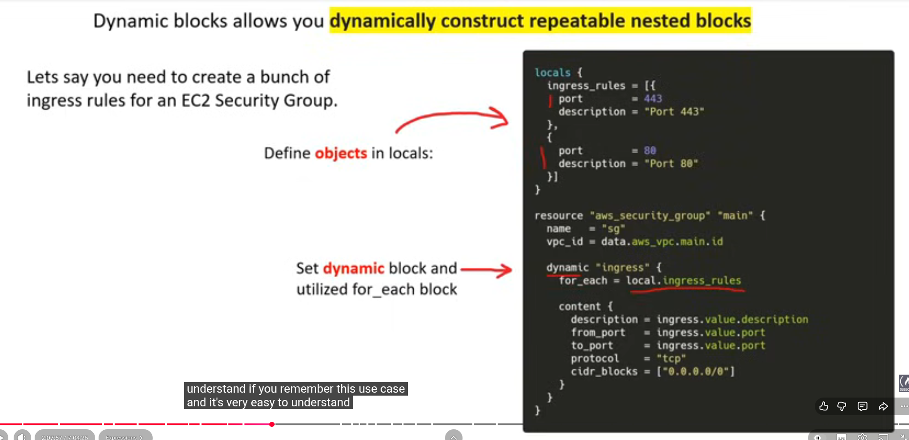

# aula3

## terraform expressions

refer to or compute values within a configuration.

## types and values
a result of a expression is a value. all values have a type.

primitive:
    string
    number
    bool

no type:
    null: underlying default of a provider resource.

complex/structural/collection:
    list: regions = ["us-east-1a", "us-east-1b"]
    map(object) = {env = "prod",priority =3}

## string templates

string interpolation: use $ "hello ${var.name}"
string directive: use %, "hello, %{ if var.name != ""} ${var.name} %{else}unnamed%{endif}!

## operators
very commun in programming languages
*
/
%
+
-
-x
==
!=
<
>
...

## conditional expressions

condition ? (if)
true_val
: else

example:
var.a != "" ? var.a :"default-a"

basicamente esta a pergunta se a diferente de "", se for ficar var.a senao fica default-a

## for expresions
accept as input: list, set, tuple, map or an object

[for s in var.list : upper(s)]

[for k, v in var.map : length(k) + lenght(v)] , get key and value

return
if:
    [] return a tuple
    {} return an object

implicit element ordering on conversion:
    maps and objects - stored by key A-Z
    sets of strings - storeb by string A-Z
    everything else - arbitrary ordering

## splat expressions
providers a shorter expression for "for" expressions, represented by a *

example:
[for o in var.list : o.id]

var.list[*].id

## dynamic blocks
allows dynamically construct repeatable nested blocks

explica me com isto:

## versions constrains
terraform uses semantic versioning, open standart
major.minor.patch

= 1.4.0 or just 1.4.0 | exactly this verison
!= 1.4.0 | any except this
>= 1.2.0 | this or newer
<= 1.2.0 | this or older
> 1.2.0 and < 2.0.0 | range
~> 1.4.0 | pessimistic. allows the rightmost part to increase, nothing above it.

example: ~> 1.4.0  accepts 1.4.1, 1.4.2... and 1.4.9. rejects 1.5.0
     ~> 1.4 accepts 1.5, 1.6 ... and 1.9. rejects 2.0

## terraform state
confition of cloud resources at a specific time

when provision infrastructure via terraform it will create a state file named terraform.tfstate

is a json data structure

terraform state list - list resources in the state
terraform state mv - move an item in the state
state pull - pull current remote state and output to stdout
state push
state replace provider
state rm
state show

## terraform state mv
rename existin resources
move resource into a module 
move module into a module

## terraform state backups

terraform will take the current state and store it in a file called terraform.tfstate.backup

backups cannot be disabled.

## terraform init
initializes your terraform project by:
    downloading plugin dependencies
    create .terraform directory
    create a dependecy lock file

terraform init -upgrade : upgrade all plugns to the latest version

terraform init -get-plugins-false: skip plugins installation

terraform init -plugins-dir=false: force plugin installation to read plugins only from target directory

terraform init -lockfile=MODE: set dependency lockfile mode

## terraaform get

to download and update modules in the root module

## introdution terraform code

commands that improve debugging:

terraform fmt - rewrites terraform configuration files to a standard format and style

terraform validadte: validates syntax

terraform console - interactive shell 

## terraform fmt

what it does:
    fixes indent
    syntax error
    terraform fmt --diff, show what will change

## terraform validate

verify syntax and internal consistent, regardless of any provided variables or existing state.

when run terraform plan or apply, validate will automatically be performe

## terraform console

interactive shell where you can evaluate expressions

## terraform plan

creates a execution plan aka terraform plan

a plan:
    readind the current state, and make sure that terraform state is up-to-date
    comparing the current configuration to the prior state
    proposing a set of change actions that should, if applied, make the remote objects match the configuration

terraform plan does not carry out proposed changed

speculative plans | savved plans
when run terraform apply | when run terraform apply -out = FILE
WILL OUTPUT THE DESCRIPTION OF THE EFFECT OF THE PALN BUT WITHOUT ANY INTENT TO APPLY IT | generate a saved plan  file which you can pass along to terraform apply terraform apply FILE, will act like auto-approve

## terraform apply

executes the actions proposed in the plan

automatic plan mode | saved plan mode
run terraform apply | run terraform apply FILE
executes plan, validate and apply | same
requires manually approve, or need a flag to auto approve -auto-approve | not required

## managed resource drift
when resources are in a different state then your expected state.

resolve drift:
replacing resources, using -replace flag
importing resources, when add a new resource,add our actual state to the state file, with import comand
refresh state:  when resource change or deleted, we use -refresh-only flag, to reflect the changes in our state file

## replacing resource
using replace flag:
    terraform apply -replace="aws_instance.example[0]"

when a cloud resource is degraded or damaged and you want to return the expected healthy state of the resource.
the flag only works for a single resource at a time.

before this we use terraform taint, but become deprecated.

## resource addressing
string that identifies zero or more resource instances.

2 parts:
[module path] [resource spec]   --> module.module_name[module index]
                                -->resource_type.resource_name[instance index]

example:
resource "aws_instance" "web"{
    #....
    count=4
}
identifies the 3 instance:
    aws_instance.web[2]

## terraform import
to import existing resources into terraform

define a placeholder for your imported resourcee in configuration file:
    resource "aws_instance" "web"{
        #.... instance config
    }
the body is blank and fill it in importing. it will not be autofilled

to import:
terraform import aws_instance.example i-abc1234

COMMAND:
terraform import <RESOURCE_ADDRESS> <ID>

can only import one resource at a time, and not resource can be imported.

## terraform refresh and refresh only mode

reads the current settings from all manage remote objects and updates the terraform state to match

will not modify real remote objects, but modify the terraform state.

terraform refresh is deprecated, use this instead:
    terraform apply -refresh-only -auto-approve

scenario: create a script that deploy a vm on aws. you ask the engineer to terminate the server, and he terminate via the aws console

Important:
you run: 
    terraform apply:
        terraform will notice thath vm is missing
        terraform will create a new vm
        the state file is correct.
        changes the infra to match state file
    
    terraform apply -refresh-only
        terraform will notice that vm you provisioned is missing
        with the refres-only flag that missing vm is intention
        terraform will propose to delete the vm from the state file
        the state file is wrong
        changes the state file to match infra.

## terraform troubleshooting

4 types errors:
    language erros: syntax error in your config files 
    state erros: resource states has changed ffrom the expected.
    core errors: a bug has occurred with core library
    providers erros: api provider has changed or does not work as expected due to emerging edge cases.

language erros: terraform fmt, terraform validate, terraform version
state erros: terraform refresh, terraform apply, terraform -replace flag
core errors: TF_LOG, open github issue
providers errors: TF_LOG, open github issue

## DEbugging terraform

has detailed logs which can be enabled by settings the TF_LOG environment to :
    trace
    debug
    infor
    warn
    error
    json

Logging can be enabled separately:
    TF_LOG_CORE
    TF_LOG_PROVIDER

Choose where you want to log with: TF_LOG_PATH

3h:05min

