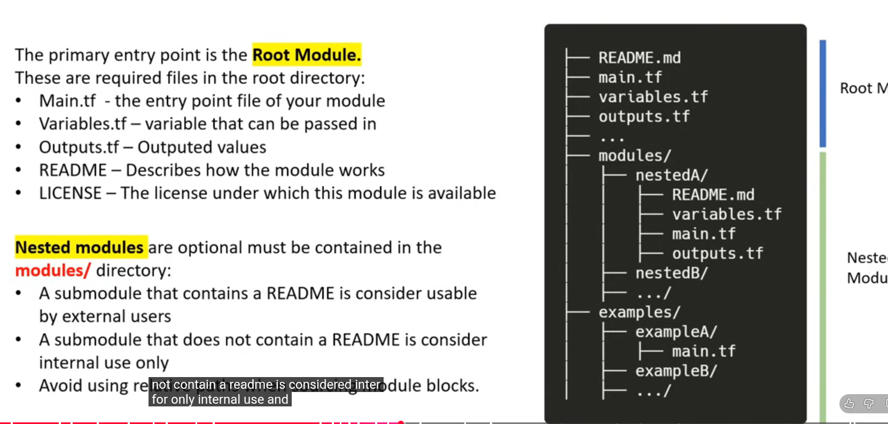

# Aula 04

## Finding modules

can be found terraform registry, only verified modules will be displayed in search terms

## Using modules

Public modules:
    integrated directly into terraform

    module "consul"{
        source = "hashicorp/consul/aws"
        version = "0.1.0"
    }

    terraform init will download and cache any modules

Private modules:
    private registry

    module "vpc"{
        source = "app.terraform.io/example_corp/vpc/aws"
        version = "0.9.3"
    }

    to configure private module access, you need to authenticate against terraform cloud via terraform login

## Publishing modules

anyone can publish modules, public modules are managed via public git repo on github
    you need modules support: versioning, generate documentation, allow browsing versions, show examples,...
    need to follow this format: terraform-<provider>-<name>

## verified modules
reviewed by hashicorp, and actively maintained.
    have badge.

## standard moudle structure

## team workflows

write -> plan -> apply

As you team and requirements grow your workflow will evolve, an this is workflow will lokk like:

individual practitioner
Teams using OSS
Teams using terraform cloud

## individual practitioner

write:
    write configuration file in your editor
    store your code in a VCS (Ex: GITHUB)
    terraform plan and validate to find syntax errors
    tight feedback loop between editing code and running tests

plan:
    commit their code to their local repository
    maybe only using a single branch ex: main
    once their commit is written, will proceed to apply

apply:
    run terraform apply and be prompted to review their plan
    after final review they will aprove the changes and await provisioning
    after sucessuful provision, push their local commits to their remote repository

## team

write:
    each team member write configuration file in your editor
    store your code in a brachn in their code repository
        avoiding conflicts while member is working on their code
        allow an oppurtunity to resolve conflict during a merge into main
    terraform plan can be used as a quick feedback loop for small teams
    for lager teams a concern over sensitive credentials becomes a concern
        ci/cd process so your credentials is abstracted away

plan:
    when a branch is ready to be incorporated on pull request an execution plan can be generated and displlayed within the pull request for review.

apply:
    to apply the merge needs to be approved and merged, which will kick of a code build server that will run terraform apply.

devOps team has to setup and maintain ci/cd
need to figure out how to store the state file
limited in their access controls
figure out a safe way to store and inject secrets
managing multiple environments

## terraform cloud
write:
    a team will use terraform cloud as their remote backend
    variables will be stored on terraform cloud
    terraform cloud integrates with your VCS to quickly setup a ci/cd
    a team member writes code to a branch and commits per usual

plan: 
    a pull request is create by a member and terraform cloud will generate thge speculative plan for review in the VCS. The member can also review and comment on the plan in terraform cloud.

apply:
    after the pull request is merge terraform cloud runtime environment will perform a terraform apply. a team member can confirm and apply.

terraform cloud streamlines a lot of the ci/cd effort, storing and security sensitive credentials and makes it is easier to go back and audit the history of multiple runs.

## Backends

defines where and how operations are performed, where state snapshots are stored.

2 types:
    standard backends:
        only store state ex: s3
        does not perform terraform operations eg: terraform apply
            use cli on your local machine
        third party backends
    
    enhanced baackends:
        store state and perform terraform operations
        subdivided:
            local: files and date are stored on a local maachine executing terraform commands
            remote: files and date are stored in the cloud eg: terraform cloud

## standard backends

terraform {
    backend "local" {
        path = "relative/path/to/terraform.state"
    }
}

can specific backend with argument local, and change the path.

data "terraform_remote_state" "networking" {
    backend ="local"
    config ={
        path = "${path.module}/networking/terraform.tfstate"
    }
}

set a backend to reference another state file so you can read its outputted values.
way of cross referencing stacks

## remote backend
is:
    terraform cloud
    terraform enterprise

when terraform apply is performed via the cli the terraform cloud run environment is responsible for execting the operaration.

your provider credentials need to be configured in environment variables in terraform cloud

need to set a terraform cloud workspaces
    set a single: via name
    set a multiple: via prefix

## cloud backend

terraform {
    cloud{
        organization ="company"
        hostname = "app.terraform.io"
        workspaces{
            tags =["app"]
        }
    }
}

you can still use backend remote for terraform cloud but its recommend to use the cloud backend block.

## backend initialization
-backend-config flag for terraform init.

2 files:
main.tf:
    terraform{
        ...
        backend "remote"{}
    }

backend,hcl:
workspaces{name ="workspace"}
organization ="company"
hostname = "app.terraform.io"

and then terraform init -backend-config =backend.hcl

## terraform remote state

retrieves the root module output values from another terraform configuration.
    via remote backend or via local backend

only root level output values from the remote state snapshot are exposed.
resource data and output values are not accesssible
to make a nested module output value accessible as a root module output value, you must explicitly configre a passthrough in the root module

## alternative of terraform remote state
use data source and reference resources

## state locking
lock your state that all operations that coul write state, prevent corrupting your state.

dibling locking: -lock flag, not recommended
force unlock: force-unlock, if someone else is holding the lock it could cause multiple writers. Requires a unique lock ID

## Protecting sensitive data:
state file can contain sensitive data eg: long lived aws credentials and is a possible attack vector.

local state:
    dont share, dont commit

remote state with terraform cloud:
    state file is held in memory not persisted to disk
    is encrypted in trasit and rest.
    have audit logging

remote state with third party storage:
    can store with various third party baackends
    review your backend capabilities
    some backends are not by default as secure as they could be:
        s3 you have to ensure encryption and versioning is turned on

## terraform ignoore file
define paths to ignore from upload via a .terraformignore file at the root of your configration directory.

works just like a gitignore with the only difference is that you cannot have multiple terraformignore files in subdirectories. Only the file in the root directory will be read.

## resources

3:37