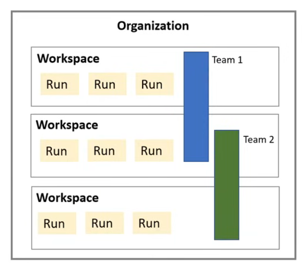

# Terraform Associate: Resumo da Aula 5 (simplificado)

---

# Parte 1: Funções (Built-in Functions)

Podes chamar funções dentro de expressões para **transformar e combinar valores**. O Terraform **não suporta funções definidas pelo utilizador**, só as integradas.

## 1. Numeric

| Função | O que faz | Exemplo |
|---|---|---|
| `abs` | Valor absoluto | `abs(-12.22)` → `12.22` |
| `floor` | Arredonda para **baixo** | `floor(4.8)` → `4` |
| `ceil` | Arredonda para **cima** | `ceil(5.1)` → `6` |
| `log` | Logaritmo | `log(16, 2)` → `4` |
| `min` / `max` | Menor / maior número | `min(1, 5, 3)` → `1` |
| `parseint` | Converte string para inteiro numa base | `parseint("1010", 2)` → `10`; `parseint("ff", 16)` → `255` |
| `pow` | Potência | `pow(3, 2)` → `9` |
| `signum` | Sinal: `-1` negativo, `1` positivo, `0` zero | `signum(-5)` → `-1` |

## 2. String

| Função | O que faz | Exemplo |
|---|---|---|
| `chomp` | Remove quebras de linha (`\n`) do fim | |
| `format` | Formata uma string | `format("hello, %s", "Luis")`; `format("there are %d lights", 5)` |
| `formatlist` | Como `format`, mas gera uma **lista** | `formatlist("hello %s", ["luis", "beatriz"])` → `["hello luis", "hello beatriz"]` |
| `indent` | Adiciona indentação a strings com várias linhas | |
| `join` | **Junta** elementos com um delimitador | `join(",", ["abc", "123"])` → `"abc,123"` |
| `split` | **Separa** uma string numa lista | `split(",", "abc,123,luis")` → `["abc", "123", "luis"]` |
| `lower` / `upper` | Minúsculas / maiúsculas | |
| `regex` / `regexall` | Procura com expressão regular (primeira ocorrência / todas) | |
| `replace` | Substitui ocorrências de uma substring | `replace("hello world", "/w.*d/", "luis")` → `"hello luis"` |
| `strrev` | **Inverte** uma string | `strrev("luis")` → `"siul"` |
| `substr` | Extrai parte da string (offset, tamanho) | `substr("bom dia luis", 1, 5)` → `"om di"` |
| `title` | Primeira letra de cada palavra em maiúscula | `title("hello world")` → `"Hello World"` |
| `trim` | Remove os caracteres indicados | |
| `trimprefix` | Remove um **prefixo** do início | |
| `trimsuffix` | Remove um **sufixo** do fim | |
| `trimspace` | Remove espaços do início **e** do fim | |

> Em `replace`, se o padrão estiver entre `/ /` é tratado como **regex**.

## 3. Collection

| Função | O que faz | Exemplo |
|---|---|---|
| `alltrue` | `true` se **todos** os elementos da lista forem `true` | `alltrue([true, false])` → `false` |
| `anytrue` | `true` se **pelo menos um** for `true` | `anytrue([true, false])` → `true` |
| `chunklist` | Divide uma lista em **blocos de tamanho fixo** | `chunklist(["a","b","c","d","e"], 2)` → `[["a","b"],["c","d"],["e"]]` |
| `coalesce` | Devolve o **primeiro argumento não nulo** (nem string vazia) | |
| `coalescelist` | Igual, mas devolve a primeira **lista** não vazia | |
| `compact` | Remove **strings vazias** de uma lista | |
| `concat` | **Junta listas** numa só | `concat([1,2], [2,3])` → `[1,2,2,3]` |
| `contains` | `true`/`false` se a lista contém o elemento | `contains(["a","b","c"], "b")` → `true` |
| `distinct` | Remove **duplicados** | |
| `element` | Devolve o elemento numa **posição** (começa em 0) | `element(["a","b","c"], 2)` → `"c"` |
| `flatten` | **Achata** listas aninhadas numa só | `flatten([[1,2],[3]])` → `[1,2,3]` |
| `index` | Devolve a **posição** de um elemento | `index(["a","b","c"], "b")` → `1` |
| `keys` | Devolve as **chaves** de um map | `keys({a=1, b=2})` → `["a","b"]` |
| `length` | **Tamanho** da lista/map/string | |
| `lookup` | Valor de uma **chave** num map, com valor por defeito | `lookup({a="ay", b="bee"}, "a", "what")` → `"ay"`; com `"c"` → `"what"` |
| `matchkeys` | Filtra uma lista com base noutra lista | `matchkeys(["i-123","i-abc","i-def"], ["us-west","us-east","us-east"], ["us-east"])` → `["i-abc","i-def"]` |
| `merge` | **Junta vários maps/objects** num só (os últimos têm prioridade) | |
| `one` | Devolve o **único elemento** de uma lista (ou `null` se estiver vazia; erro se tiver mais de um) | `one([])` → `null` |
| `range` | Gera uma sequência de números | `range(5)` → `[0,1,2,3,4]`; `range(1,8,2)` → `[1,3,5,7]` |
| `reverse` | **Inverte a ordem** de uma lista | `reverse([1,2,3])` → `[3,2,1]` |
| `setintersection` | Elementos **em comum** entre sets | |
| `setproduct` | **Todas as combinações** entre sets | `setproduct(["a","b"], ["c","d"])` → `a,c / a,d / b,c / b,d` |
| `setsubtract` | Subtrai um set a outro | `setsubtract(["a","b","c"], ["a","c"])` → `["b"]` |
| `slice` | Extrai elementos consecutivos (início inclusivo, **fim exclusivo**) | `slice(["a","b","c","d"], 1, 3)` → `["b","c"]` |
| `sort` | Ordena (do menor para o maior) | `sort(["e","d","a","x"])` → `["a","d","e","x"]` |
| `sum` | Soma os elementos | |
| `transpose` | Troca chaves e valores num map de listas | |
| `values` | Devolve os **valores** de um map | |
| `zipmap` | Constrói um **map** a partir de uma lista de chaves e outra de valores | `zipmap(["a","b"], [1,2])` → `{a=1, b=2}` |

> **`element` e o wrap-around:** se o índice for maior que a lista, **dá a volta**. Ex.: `element(["a","b","c"], 7)` → `"b"` (7 mod 3 = 1).

## 4. Encoding e Decoding

`base64encode()`, `base64decode()`, `jsonencode()`, `jsondecode()`, `yamlencode()`... (entre outras).

## 5. Filesystem

| Função | O que faz |
|---|---|
| `abspath` | Devolve o caminho absoluto |
| `dirname` | Remove a **última parte** do caminho (fica com a pasta) |
| `basename` | Devolve **só a última parte** do caminho |
| `pathexpand` | Expande `~/path` para o caminho absoluto |
| `file(path)` | **Lê o conteúdo** de um ficheiro |
| `templatefile(path, vars)` | Lê um ficheiro de **template** e substitui as variáveis |
| `fileexists` | `true`/`false` se o ficheiro existe |
| `fileset` | Lista ficheiros que **correspondem a um padrão**. Ex.: `fileset(path, "error*")` devolve `error_log.txt` e `error_test.php` |
| `filebase64` | Lê o ficheiro e devolve em **base64** |

## 6. Date e Time

- `formatdate`: converte um timestamp para outro formato
- `timeadd`: adiciona uma duração a um timestamp
- `timestamp`: devolve a data/hora atual

## 7. Hash e Crypto

Geram hashes e funções criptográficas: `bcrypt()`, `md5()`, `sha256()`...

## 8. IP Network

| Função | Exemplo |
|---|---|
| `cidrhost` | IP completo de um host dentro de uma rede: `cidrhost("10.12.127.0/20", 16)` → `10.12.112.16` |
| `cidrnetmask` | Devolve a máscara: `cidrnetmask("172.16.0.0/12")` → `255.240.0.0` |
| `cidrsubnet` | Uma sub-rede: `cidrsubnet("172.16.0.0/12", 4, 2)` → `172.18.0.0/16` |
| `cidrsubnets` | Várias sub-redes: `cidrsubnets("10.1.0.0/16", 4, 4, 8, 4)` → `10.1.0.0/20`, `10.1.16.0/20`, `10.1.32.0/24`, `10.1.48.0/20` |

## 9. Type Conversion

| Função | O que faz |
|---|---|
| `can` | Avalia a expressão e devolve `true` se **não der erro**, senão `false` |
| `try` | Devolve o **primeiro** argumento que **não der erro** (útil como valor de recurso) |
| `sensitive` | Marca um valor como **sensível** |
| `nonsensitive` | **Remove** a marca de sensível (expõe o valor) |
| `tobool`, `tomap`, `toset`, `tolist`, `tonumber`, `tostring` | Convertem para o tipo respetivo |

---

# Parte 2: HCP Terraform

(Antigo **Terraform Cloud**.) Aplicação que **ajuda equipas a usar o Terraform em conjunto**.

## 10. Termos

**Hierarquia:** uma **Organization** contém **Projects**; cada Project agrupa vários **Workspaces**; cada Workspace tem várias **Runs**. As **Teams** atravessam workspaces (cada equipa pode ter acesso a um ou mais workspaces ou projects).


## 11. Run Workflows

Tens de **escolher um** de 3 tipos:

| Workflow | Como funciona |
|---|---|
| **Version control (VCS)** | Integrado com uma **branch** do VCS. Num **pull request** geram-se **speculative plans**; num **merge** dispara-se uma run no HCP Terraform |
| **CLI-driven** | As runs são disparadas por um utilizador que corre comandos do **Terraform CLI** na sua máquina |
| **API-driven** | Um sistema de terceiros dispara runs **fazendo upload da configuração** pela API do HCP Terraform (envias uma *configuration version*) |

> **Remote operations:** com o bloco `cloud`, os comandos `plan` e `apply` **correm no HCP Terraform** (não na tua máquina). O CLI só mostra o output.

## 12. Permissões

### Ao nível da Organization

Gerem recursos ou definições de **toda a organização**:

- Policies
- Policy overrides
- Workspaces
- VCS settings

**Organization owners:** papel especial com **todas** as permissões.

### Ao nível do Project

- Podes atribuir **permissões a uma equipa para um project inteiro**, em vez de workspace a workspace.

### Ao nível do Workspace

Gerem recursos ou definições de **um workspace específico**.

**General Workspace Permissions** (granulares, via *custom workspace permissions*):

- Read runs, Queue plans, Apply runs
- Lock and unlock workspaces
- Download Sentinel mocks
- Read variable, Read and write variables
- Read state outputs, Read state versions, Read and write state versions

**Fixed Permission Sets** (pré-definidos):

| Conjunto | Permissões |
|---|---|
| **Read** | Read runs, read variables, read state versions |
| **Plan** | Queue plans, read variables, read state versions |
| **Write** | Apply runs, lock/unlock workspaces, download Sentinel mocks, read and write variables, read and write state versions |

**Workspace Admin:** papel especial com todas as permissões, mais:

- Read and write **workspace settings**
- Set or remove workspace permissions of **any team**
- **Delete** workspace

## 13. API Tokens

3 tipos: **user**, **team** e **organization**.

| Token | Características |
|---|---|
| **Organization** | Permissões em **toda a organização**; só **um token válido** de cada vez; **só owners** geram ou revogam; pensado para **criar e configurar workspaces e teams** |
| **Team** | **Um por equipa**; dá acesso aos workspaces da equipa; **qualquer membro** pode gerar ou revogar; ao regenerar, o anterior fica **inválido** |
| **User** | **Herda as permissões** do utilizador; serve para uma pessoa ou para uma máquina |

## 14. Outras funcionalidades

- **Private registry:** publicas módulos privados para a organização. **Todos os utilizadores** da organização podem ver o registry privado.
- **Cost estimation:** mostra o **custo mensal** estimado dos recursos junto às runs. Disponível a partir do plano **Standard**.
- **VCS integration:** GitHub, GitLab, Bitbucket...
- **Agents (self-hosted):** permitem comunicar com infraestrutura **isolada, privada ou on-premises**. Os planos diferem no número de **runs de agent concorrentes** (ver Parte 4).

### Migrar o state local para o HCP Terraform

1. Criar um **workspace** no HCP Terraform
2. Autenticar com `terraform login`
3. Substituir a configuração por um **remote backend** (bloco `cloud`)
4. Correr `terraform init` e **copiar o state existente** respondendo `yes`

### Run Environment

**VM ou container** onde o código corre (basicamente um **code build server**). Em cada run, são injetadas variáveis de ambiente:

| Variável | Conteúdo |
|---|---|
| `TFC_RUN_ID` | ID da run |
| `TFC_WORKSPACE_NAME` | Nome do workspace |
| `TFC_WORKSPACE_SLUG` | Slug completo (organização/workspace) |
| `TFC_CONFIGURATION_VERSION_GIT_BRANCH` | Branch Git usada |
| `TFC_CONFIGURATION_VERSION_GIT_COMMIT_SHA` | SHA do commit |

## 15. Projects

- **Project:** agrupa **workspaces** dentro de uma organização.
- Permite atribuir **permissões a nível de project** a equipas.
- Ajuda a organizar workspaces por equipa, aplicação ou ambiente.

## 16. Variable sets

- **Variable set:** coleção de variáveis (Terraform e de ambiente) **reutilizável em vários workspaces/projects**.
- Pode ser aplicada **globalmente** (toda a organização), a **projects** específicos ou a **workspaces** específicos.
- Evita repetir credenciais e variáveis comuns em cada workspace.

## 17. Dynamic provider credentials

- Em vez de guardar chaves estáticas no workspace, o HCP Terraform obtém **credenciais temporárias** do provider (ex.: AWS, Azure, GCP, Vault) por **autenticação federada (OIDC)**, **a cada run**.
- Vantagens: **sem credenciais de longa duração**, rotação automática, menor superfície de ataque.

## 18. Governação e visibilidade

| Funcionalidade | O que faz |
|---|---|
| **Health assessments** | Verificam a saúde dos workspaces: **drift detection** (a infra mudou fora do Terraform) e **continuous validation** (blocos `check`) |
| **Explorer** | Vista **entre workspaces**: versões, providers, módulos, estado de saúde |
| **Change requests** | Pedidos associados a workspaces para acompanhar alterações necessárias |
| **Policy enforcement** | Policies **Sentinel** e **OPA**, agrupadas em **policy sets**, aplicadas a workspaces ou projects |
| **Teams e permissões** | Ver secção 12 |
| **Private registry** | Ver secção 14 |

---

# Parte 3: Terraform Enterprise

> **Nota 004:** o Terraform Enterprise e os seus requisitos de hardware **não aparecem nos objetivos do 004**. Prioridade baixa. Os valores abaixo vêm do curso (podem estar desatualizados).

Distribuição **self-hosted** da plataforma Terraform.

- **Sem limites** de recursos
- Funcionalidades enterprise: **audit logging**, **SAML / SSO**

### Arquitetura

Uma **máquina Linux** com o Terraform Enterprise instalado, ligada a:

- Um **certificado TLS**
- Uma **base de dados Postgres**
- **Cloud storage ou disco** (ex.: S3)

### Requisitos

**Operational mode** (onde guardar os dados):

| Modo | Descrição |
|---|---|
| **External** | Serviços externos (ex.: S3, Postgres) |
| **Mounted disk** | Diretório num disco externo (EBS, iSCSI) |
| **Demo** | Para testes/demonstração |

**Credenciais:**

- **Licença** do Terraform Enterprise
- **Certificado TLS** e **chave privada**

**Sistema:** instância **Linux** (Red Hat, Ubuntu, Debian...)

**Hardware mínimo (segundo o curso):**

| Recurso | Mínimo |
|---|---|
| Disco (root volume) | **10 GB** |
| Disco (Docker data directory) | **40 GB** |
| RAM | **8 GB** |
| CPU | **4 cores** |

### Air-gapped environments

Ambientes **sem internet**, sem conectividade externa.

---

# Parte 4: Planos

> Os planos mudaram: o curso fala de Free / Teams & Governance / Business. Os planos atuais do HCP Terraform são **Free, Essentials, Standard e Premium**. Os preços **não saem no exame**; interessa saber que funcionalidades existem.

| Plano | Resumo |
|---|---|
| **Free** | Até **500 managed resources**; 1 run remota concorrente |
| **Essentials** | Tudo do Free + colaboração; **pay-as-you-go**; 3 runs remotas concorrentes |
| **Standard** | Tudo do Essentials + governação (**policy enforcement**, **cost estimation**); 10 runs remotas concorrentes |
| **Premium** | Tudo do Standard + **audit logging**, **custom RBAC**, suporte prioritário; 200 runs remotas concorrentes |
| **Terraform Enterprise** | Versão **self-hosted** |

- A faturação é por **managed resource** (por hora), **não por utilizador**.
- Cada plano pago é um **superconjunto** do anterior.
- Os **agents** existem em todos os planos, com limites de concorrência diferentes (Free 1, Essentials 1, Standard 10, Premium 300).

**Funcionalidades comuns a todos (incluindo OSS):** IaC, workspaces, variáveis, runs, resource graph, providers, módulos, public module registry.

**A partir do Free (cloud):** remote state, ligação ao VCS, workspace management, armazenamento seguro de variáveis, remote runs, **private module registry**.

---

# Parte 5: Workspaces

Permitem gerir **vários ambientes** ou **state files alternativos** (ex.: dev, prod).

| Tipo | Descrição |
|---|---|
| **CLI workspaces** | Gerem state files alternativos, localmente ou via remote backends |
| **HCP Terraform workspaces** | Funcionam como **diretórios de trabalho completamente separados** |

- Pensa nos workspaces como **branches num repositório Git**. Tecnicamente, equivalem a **mudar o nome do state file**.
- Por defeito, tens um workspace chamado **`default`** no backend local. O `default` **nunca pode ser apagado**.

### Internals: onde fica o state

| Local state | Remote state |
|---|---|
| Guardado na pasta **`terraform.tfstate.d`** | Guardado **diretamente no backend** configurado |
| Equipas/indivíduos às vezes fazem commit destes ficheiros (má ideia) | **Recomendado** quando há vários colaboradores |

### Workspace atual na configuração

Referes o nome do workspace atual com **`terraform.workspace`**:

```hcl
resource "aws_instance" "example" {
  count = terraform.workspace == "default" ? 5 : 1

  tags = {
    Name = "web - ${terraform.workspace}"
  }
}
```

### HCP Terraform workspaces

1. Cria uma **organization**
2. Vai a **Workspaces → Create workspace**
3. Consulta: **Overview**, **Runs**, **States**, **Variables**, **Settings**...

- **Runs:** vês as últimas runs e o que foi criado, alterado ou destruído.
- **States:** tens um **snapshot de todas as versões** e vês as mudanças feitas.

### Run Triggers

Ligam um workspace a **um ou mais workspaces de origem** da mesma organização. Quando um **apply** nos workspaces de origem termina com **sucesso**, uma run é **colocada automaticamente em fila** no workspace ligado.

- Servem para **encadear workspaces** (ex.: rede → aplicação).
- Combinam bem com `terraform_remote_state` (Aula 4) para partilhar outputs entre workspaces.

### Comandos `terraform workspace`

| Comando | Função |
|---|---|
| `terraform workspace list` | Lista todos |
| `terraform workspace show` | Mostra o workspace atual |
| `terraform workspace select <nome>` | Muda de workspace |
| `terraform workspace new <nome>` | Cria **e muda** para o novo |
| `terraform workspace delete <nome>` | Apaga um workspace |

---

## Pontos-chave para decorar

**Funções**
1. `floor` arredonda para baixo, `ceil` para cima; `signum` devolve -1, 0 ou 1.
2. `join` junta, `split` separa; `format` formata; `formatlist` devolve lista.
3. `lookup(map, chave, default)`; `element` dá a volta (wrap-around) e começa em 0.
4. `concat` junta listas; `merge` junta maps; `zipmap` cria map; `setproduct` = combinações.
5. `file()` lê um ficheiro; `templatefile()` renderiza um template; `fileset` procura por padrão.
6. `can` devolve `true` se a expressão **não** der erro; `try` devolve o primeiro valor sem erro; `sensitive` / `nonsensitive`.

**HCP Terraform**

7. Hierarquia: **Organization → Projects → Workspaces → Runs**; Teams atravessam workspaces.
8. 3 workflows: **VCS**, **CLI-driven**, **API-driven**.
9. Permissões de workspace: **Read, Plan, Write, Admin**; podem também ser dadas **por project**.
10. Tokens: **organization** (1 só, só owners), **team** (1 por equipa), **user** (herda permissões).
11. **Variable sets** = variáveis partilhadas por vários workspaces/projects.
12. **Dynamic credentials** = credenciais temporárias por OIDC, a cada run.
13. Governação: **health assessments** (drift + continuous validation), **explorer**, **change requests**, **policy enforcement** (**Sentinel** ou **OPA**).
14. Planos atuais: **Free (500 resources), Essentials, Standard, Premium**; cobrança **por managed resource**.
15. **Policy enforcement** e **cost estimation**: a partir do **Standard**; **audit logging**: **Premium**.
16. Migrar state: criar workspace → `terraform login` → bloco `cloud` → `terraform init` → `yes`.
17. Com o bloco `cloud`, `plan` e `apply` correm **remotamente** (remote operations).

**Terraform Enterprise** (prioridade baixa)

18. Self-hosted, Linux, **TLS cert + licença**, Postgres + storage.
19. Operational modes: **external, mounted disk, demo**.

**Workspaces**

20. Workspace `default` **não pode ser apagado**.
21. Local: `terraform.tfstate.d`; referência: **`terraform.workspace`**.
22. Comandos: `workspace list | show | select | new | delete`.
23. **Run triggers**: apply bem-sucedido numa origem enfileira uma run no workspace ligado.