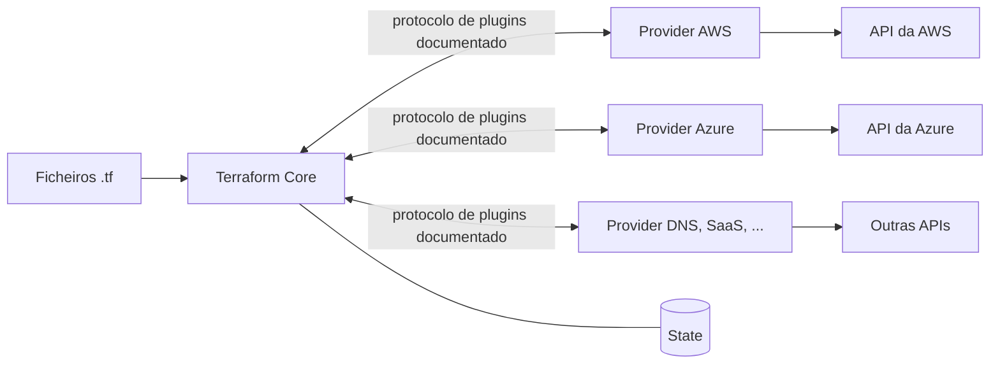
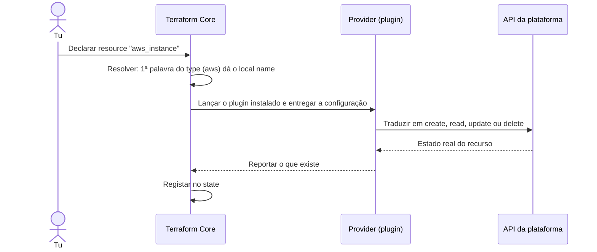
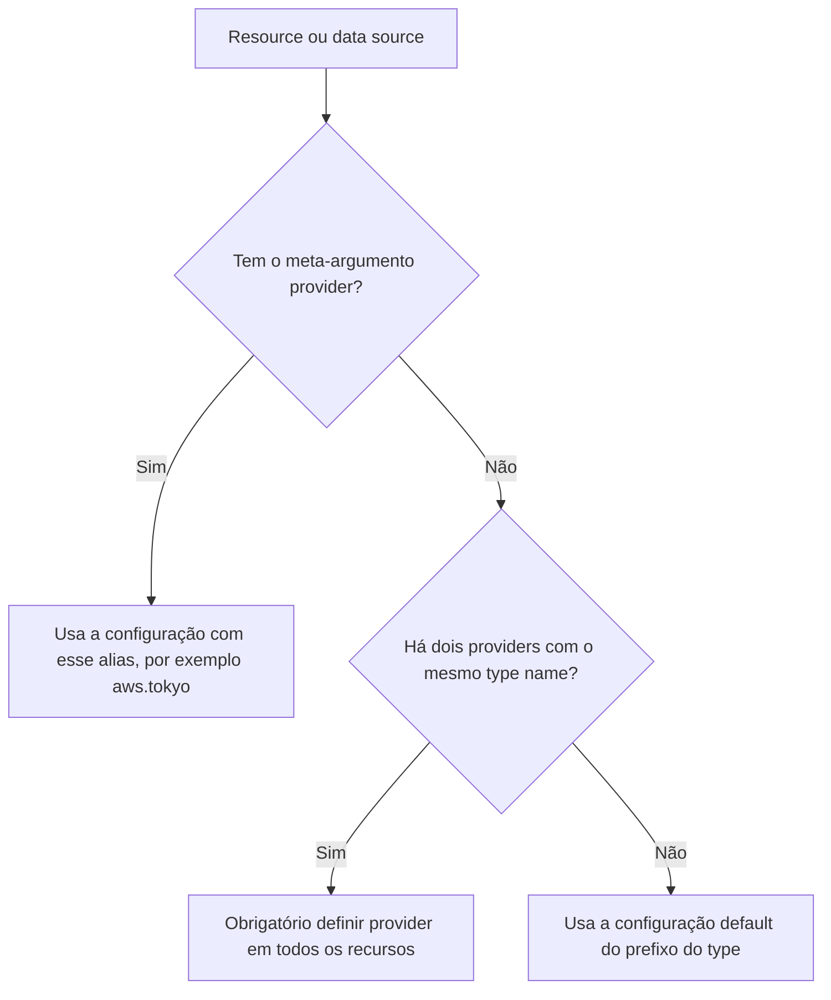

# Aula 02 – Arquitetura: Core, Providers e Registry

## 1. Duas metades, lançadas em separado

O **Terraform Core não sabe nada sobre nenhuma cloud**. Todo o conhecimento sobre plataformas vive em **plugins** (os providers).



| | **Terraform Core** | **Providers** |
|---|---|---|
| Papel | Decide **o que** tem de mudar | Traduz essas decisões em **chamadas reais à API** |
| Faz | Lê a configuração, constrói o grafo de dependências, gere o state, calcula o plan | Define resource types e data sources, autentica, conhece endpoints e regiões, mapeia o ciclo de vida para a API |
| Não faz | Nada específico de uma plataforma | **Não** guarda state, **não** planeia, **não** ordena operações |

> **Regra de bolso:** se o comportamento é específico da plataforma, é do **provider**. Se tem a ver com grafos, plans ou state, é do **core**.

### Características dos providers

- São **programas separados escritos em Go**, lançados pelo core, que comunica com eles através de um protocolo de plugins documentado.
- **Têm versões independentes** do Terraform.
- **Não fazem parte do binário** do Terraform e só são descarregados quando corres `terraform init`.
- Existem mais de **3000**: cloud, on-premises, SaaS, DNS, bases de dados, controlo de versões, monitorização.

> **Exame:** o versionamento independente é a razão de `required_version` e `required_providers` serem **duas definições separadas**. Limitam coisas diferentes.

---

## 2. O que acontece quando declaras um recurso



| Passo | O que se passa |
|---|---|
| **Declare** | Escreves um resource com um type, por exemplo `aws_instance` |
| **Resolve** | O core lê a **primeira palavra do type** para encontrar o local name do provider |
| **Launch** | O core arranca o plugin instalado e entrega-lhe a configuração |
| **Translate** | O provider converte create/read/update/delete em chamadas reais à API |
| **Return** | O provider reporta o que existe e o core regista-o no **state** |

> A primeira palavra do type **não é decoração**: é assim que o Terraform escolhe que plugin trata daquele recurso.

---

## 3. Os três níveis do Registry

| Nível | Quem publica | Verificação |
|---|---|---|
| **Official** | HashiCorp | Sim |
| **Partner** | Parceiros da HashiCorp | Sim (verified publisher) |
| **Community** | Indivíduos ou organizações da comunidade | Nenhuma formal |

> **Exame:** o nível indica o **suporte**, não a forma de instalação. Os três instalam-se **exatamente da mesma maneira**, com `terraform init`.

---

## 4. Source address

Tem **3 partes**: `HOSTNAME/NAMESPACE/TYPE`

```
registry.terraform.io / hashicorp / aws
└──── hostname ──────┘ └ namespace ┘ └ type ┘
```

| Parte | Significado |
|---|---|
| **Hostname** | Opcional. Por omissão é `registry.terraform.io` |
| **Namespace** | A organização que publica |
| **Type** | A plataforma |

- O source address é o **identificador global** do provider.
- Republicar o mesmo provider sob outro namespace faz o Terraform tratá-lo como um **provider completamente diferente**.

> **Exame:** os source addresses não distinguem maiúsculas de minúsculas, mas escrevem-se os types em minúsculas. `registry.terraform.io/hashicorp/aws` e `hashicorp/aws` são **o mesmo provider**.

---

## 5. Source address vs. local name

| | **Source address** | **Local name** |
|---|---|---|
| Âmbito | Global | Por módulo |
| Utilização | Usado **uma vez** | Usado **em todo o lado** |
| Função | Identifica o provider no mundo inteiro | O teu nome para ele dentro deste módulo |
| Onde aparece | Só em `required_providers` | Em `provider` blocks e nos prefixos dos resources |
| Formato | `namespace/type` | Livre, mas **único dentro do módulo** |
| Quem escolhe | Igual para toda a gente | Tu (mas raramente deves mudar o habitual) |

> O **local name é a chave** em `required_providers`. O **source address é o valor**. Tudo o resto refere-se ao local name.

---

## 6. `required_providers`: declarar antes de configurar

- Fica **dentro do bloco `terraform`** de topo.
- Todos os módulos devem declarar os providers de que precisam.
- Cada entrada leva um `source` e, fortemente recomendado, uma **version constraint**.
- O `terraform init` lê este bloco, descarrega os plugins e **regista as versões exatas no lock file**.
- **Escreve sempre o `source` explicitamente.** O namespace `hashicorp` implícito é uma ajuda transitória, não uma comodidade.

### `required_providers` vs. `provider` block

| | **`required_providers`** | **`provider` block** |
|---|---|---|
| Responde a | **Qual** plugin e **que** versão | **Como** o plugin se comporta |
| Localização | Dentro do bloco `terraform` | Bloco de topo na configuração |
| Contém | Source address e version constraint | Região, endpoints, credenciais, defaults |
| Obrigatório? | Sim (para fixar a origem e a versão) | Opcional, se o provider não precisar de definições |
| Lido por | `terraform init` | `plan` e `apply` |

> **Declaração instala. Configuração parametriza.** Um `provider` block sozinho **não instala nada**.

### Exemplo

```hcl
terraform {
  # Define os providers necessários
  required_providers {
    aws = {
      source  = "hashicorp/aws"
      version = "~> 5.0"
    }
  }

  # Versão mínima do Terraform
  required_version = ">= 1.5.0"
}

provider "aws" {
  # Região onde os recursos serão criados
  region = "eu-north-1"
}
```

---

## 7. Configurar o provider e autenticação

- O `provider` block usa o **local name**, não o source address.
- Os argumentos são específicos de cada provider (`region`, `endpoint`, `profile`, ...).
- **Nunca coloques credenciais diretamente no `provider` block.**
- Prefere variáveis de ambiente, a cadeia de credenciais da própria plataforma, ou credenciais dinâmicas de curta duração.

> É a mesma regra dos segredos da aula 1, um nível abaixo: **configuração em controlo de versões, credenciais nunca.**

---

## 8. Aliases: várias configurações do mesmo provider

- Um `provider` block com o argumento `alias` cria uma **configuração adicional** ao lado da default.
- O bloco **sem alias** é a configuração **default**, usada por qualquer recurso que não diga o contrário.
- É a resposta para **duas regiões, duas contas ou duas subscrições** na mesma configuração.
- Um recurso escolhe uma configuração com o meta-argumento `provider`, escrito como `local_name.alias`.
- Os aliases **não instalam nada de extra**: é **um só plugin**, configurado mais do que uma vez.

```hcl
provider "aws" {
  region = "eu-north-1"      # default
}

provider "aws" {
  alias  = "tokyo"
  region = "ap-northeast-1"
}

resource "aws_instance" "em_toquio" {
  provider = aws.tokyo
  # ...
}
```

> **Objetivo 2c:** escrever configuração com vários providers. Os aliases são a forma de usar o mesmo provider duas vezes.

### Que configuração usa um recurso?



| Situação | O que o Terraform faz |
|---|---|
| Sem meta-argumento `provider` | Usa a configuração **default** para o prefixo do type |
| `provider = aws.tokyo` | Usa a configuração com **esse alias** |
| Dois providers com o mesmo type name | Tens de definir `provider` **em todos os recursos** |
| Módulo filho precisa de um alias | Passa-se com o meta-argumento **`providers`** |
| Módulo filho define a sua própria configuração | **Desaconselhado.** Passa a configuração em vez disso |

> Os módulos herdam **apenas as configurações default**. As que têm alias **têm de ser passadas**.

---

## 9. Quando dois providers querem o mesmo nome

- Os local names têm de ser **únicos por módulo**. Dois providers do tipo `http` de namespaces diferentes vão colidir.
- **Recomendação da HashiCorp:** local names compostos que juntam namespace e type, como `hashicorp-http` e `mycorp-http`.
- Assim, o Terraform **deixa de conseguir inferir** o provider a partir do prefixo do type.
- Logo, cada resource e data source afetado tem de levar o meta-argumento `provider` explícito.
- É mais texto, e de propósito: **a ambiguidade custa muito mais do que a verbosidade.**

> Renomear quebra o atalho do prefixo. É esse o custo, e é por isso que o conselho por omissão é manter os local names preferidos.

---

## 10. Providers que quebram o padrão

**O provider incorporado (built-in):**
- Source address: `terraform.io/builtin/terraform`
- É o que alimenta o `terraform_remote_state`.

> Um source address é **primeiro um identificador** e só depois uma localização de download. Não tem de apontar para um serviço real.

---

## 11. Onde aterram os plugins

O `terraform init` descarrega os providers para o diretório **`.terraform`**, dentro da pasta de trabalho.

| | **`.terraform/`** (diretório) | **`.terraform.lock.hcl`** (ficheiro) |
|---|---|---|
| Natureza | Pasta de trabalho, descartável | Registo das versões exatas dos providers |
| Git | **Ignorar** (`.gitignore`) | **Fazer commit** |

- Os binários dos providers são grandes. Descarregá-los por projeto e por branch acumula espaço rapidamente.
- Uma **plugin cache** partilha **uma só cópia** por todas as configurações da máquina.

> Dois nomes quase iguais, tratamento oposto: **ignora o diretório `.terraform`, faz commit do ficheiro `.terraform.lock.hcl`.**

---

## 12. Ler o cenário (atalhos para o exame)

| Se o cenário diz... | A resposta é... |
|---|---|
| Duas regiões ou duas contas | **Provider aliases** + meta-argumento `provider` |
| Provider errado instalado ou não encontrado | `source` omitido; foi assumido o namespace `hashicorp` implícito |
| Sistema proprietário, nunca publicado | Provider **interno (in-house)**, obtido a partir do sistema de ficheiros |
| Que versões são aceitáveis? | **`required_providers`**, não o `provider` block |
| Que região? | **`provider` block** |
| Módulo filho precisa do alias | Meta-argumento **`providers`** no bloco `module` |


30min:25s